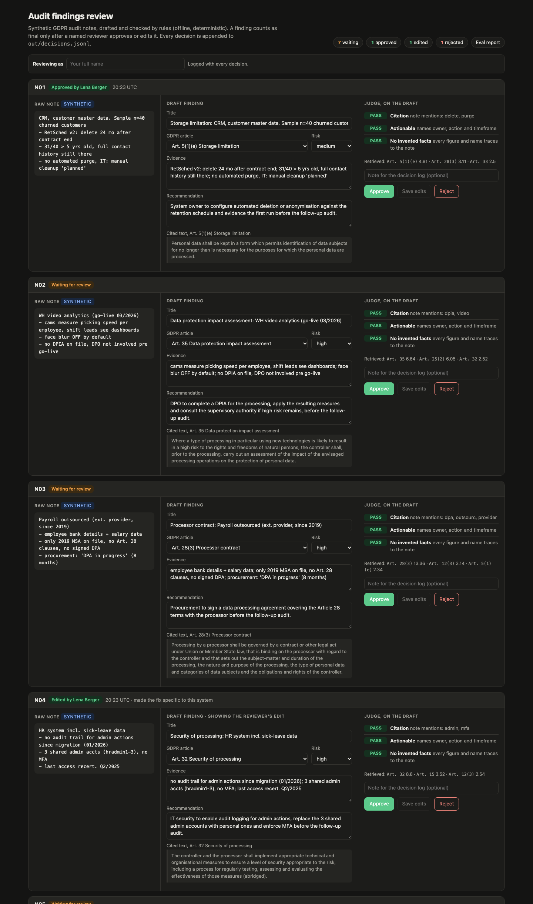
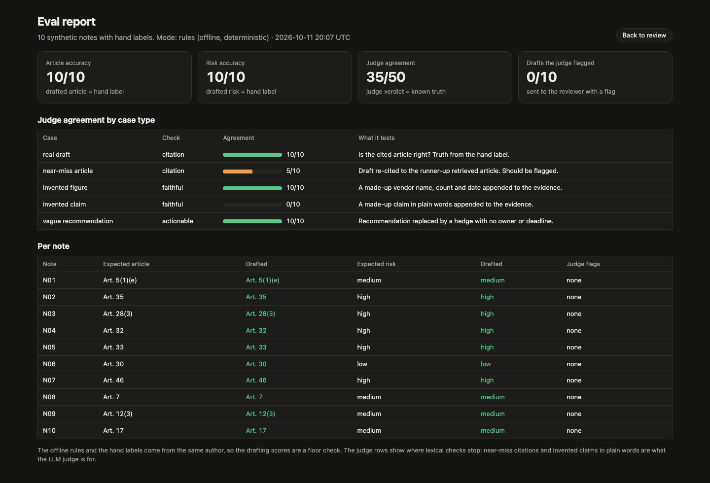

# GDPR audit findings: draft, judge, sign-off

Turns raw auditor notes on GDPR controls into structured findings (title, article, risk, evidence, recommendation), grounded in article text retrieved from the regulation.
An LLM-as-judge rubric checks every draft: is the cited article right, is the recommendation actionable, does every fact trace back to the note.
A named reviewer approves, edits or rejects each finding on one local screen, every decision is appended to a JSONL log, and an eval harness scores the whole loop.



## Run it

```bash
pip install -r requirements.txt   # Python 3.10+, ideally in a fresh venv
python evals.py                   # draft and judge every note, print the scores
python server.py                  # reviewer screen on http://127.0.0.1:8765
```

Tests: `python -m pytest -q` (6 tests, offline).

It runs fully offline by default, with a deterministic rules engine: no key, no network. Set `ANTHROPIC_API_KEY` and the same graph drafts and judges with `claude-haiku-5-5` through the Anthropic Messages API, using structured JSON output and a hard USD 0.05 cap per run. LLM calls and spend are printed with the scores.

## Eval

Rules mode (offline, deterministic), 10 synthetic notes with hand labels:

| metric | score |
| - | - |
| article accuracy | 10/10 |
| risk accuracy | 10/10 |
| judge agreement, all cases | 35/50 (70%) |
| citation: real draft | 10/10 |
| citation: near-miss article | 5/10 |
| faithful: invented figure | 10/10 |
| faithful: invented claim | 0/10 |
| actionable: vague recommendation | 10/10 |
| real drafts the judge flagged | 0/10 |

- **Drafting.** The rules and the labels were written by the same person, so 10/10 only shows the plumbing works. It is a baseline, not a benchmark.
- **Judge.** The offline judge catches invented figures and names, and hedged recommendations. It accepts half of the near-miss citations (the draft re-cited to the retrieval runner-up) and every invented claim written in plain words. Those two rows are what the LLM judge is for, and the first thing to read when it runs.
- **Judge agreement** compares the judge's verdict with known truth on 50 cases: the 10 real drafts (is the citation right, per the label) plus 4 deliberately broken copies of each.



## How it works

- `pipeline.py`: a LangGraph graph `retrieve -> draft -> judge`. Retrieval is BM25 over 15 GDPR article excerpts in `data/gdpr.json`, abridged from [EUR-Lex](https://eur-lex.europa.eu/eli/reg/2016/679/oj). The drafter may only cite a retrieved article; in LLM mode that is an enum in the output schema.
- Judge rubric: **citation** (offline: the note contains an anchor phrase for the cited article), **actionable** (an owner, an action and a timeframe, no hedging), **faithful** (every figure, ID and proper name appears in the note or in the cited text).
- `evals.py`: accuracy against `data/labels.json`, judge agreement, then it writes `out/run.json` (the review queue) and `out/eval.json`.
- `server.py`: FastAPI. Binds 127.0.0.1, checks Host and Origin, accepts JSON-only POSTs with a size cap, escapes every rendered value and sends a nonce CSP. A decision covers the exact draft it was made on: if a re-run changes a draft, the finding goes back to the queue and the old decision stays in the log.
- Each line of `out/decisions.jsonl` has the time (UTC), reviewer, action, note, mode, the judge flags at decision time, the draft as shown, and the final finding (null for a rejection).

Risk rubric, used by both modes: high for special-category or financial data, systematic monitoring, a breach notified late, or a transfer without safeguards; low for a documentation gap where the control works in practice; medium for everything else.

## Data

The 10 notes in `data/notes.json` are synthetic, written in auditor shorthand. No real company, system, person or incident.

## Not built yet

- Embeddings and re-ranking. Lexical BM25 is enough for 15 articles.
- A judge-to-redraft edge in the graph. For now, flagged drafts go to the reviewer.
- Login. Locally the reviewer types their name; behind SSO, take it from the session.
- Postgres or pgvector. JSON files and a JSONL log cover a demo of this size.
